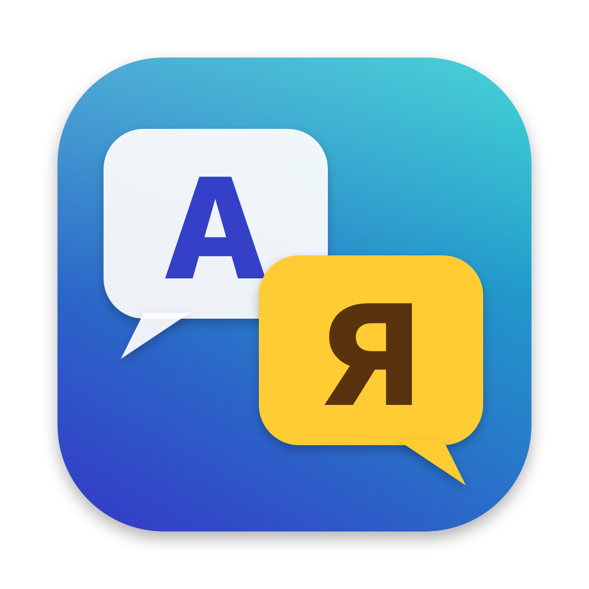

🌐 **English** · [Русский](docs/README.ru.md)

# Switch Translator

A desktop app for macOS and Windows that translates Nintendo Switch games. It opens the game image
(NSP/NSZ) together with its updates and DLC, finds the text, voice-over, videos and fonts, translates everything
with free or paid services, re-voices the dialogue, and builds a mod for Atmosphère (or a ready-made NSP/NSZ with
the translation).



The interface is available in 11 languages: English, Русский, Español, Italiano, Deutsch, Français, Português,
中文, 日本語, हिन्दी, العربية. Language is picked from the system and can be changed in Settings.

## Download

Get the [latest release](https://github.com/Kohinor46/switch-translator/releases/latest):

- **macOS 12+** (Apple Silicon and Intel): `SwitchTranslator-macOS.dmg`. Drag the app to Applications.
  The app is not notarized, so macOS blocks the first launch: right-click the app → **Open**
  (or **Open Anyway** in System Settings → Privacy & Security).
- **Windows 10/11 x64**: `SwitchTranslator-Windows.zip`. Unpack and run `Switch Translator.exe`.
  If SmartScreen warns about an unknown publisher, click **More info → Run anyway**.

The app checks GitHub for new versions at startup (it can be switched off in Settings) and updates itself:
it downloads the archive, verifies its SHA-256 from the GitHub release, replaces itself and restarts.
Help → Check for Updates does the same on demand.

## What you need

- `prod.keys` (and `title.keys` if needed) **from your own console**. Lockpick_RCM dumps them; the app finds them
  on the SD card or in `~/.switch`. Downloading other people's keys is illegal.
- That's it. ffmpeg and whisper.cpp are built into the app; voices, speech models and Python environments for
  local TTS are downloaded by the app itself when you press the corresponding button.

## How it works

The tabs follow the workflow:

1. **Game** — choose the image, keys, updates and DLC.
2. **What was found** — engine, text, sound, video and fonts in the game; choose the source language version.
3. **Speech to text** — voice lines and video speech are recognized with the built-in Whisper.
4. **Translation** — all text (game lines, recognized speech, video phrases) is translated together with a game
   glossary (names, places, items), so terms stay consistent. Free: MyMemory, LibreTranslate, DeepL Free;
   paid: Google, ChatGPT, Claude (also via a Claude/Codex subscription).
5. **Voice-over** — translated speech is voiced: offline Piper, Silero, XTTS-v2 (voice cloning), RHVoice, system
   voices; online Azure, Yandex SpeechKit, SaluteSpeech, Gemini, Google Cloud, OpenAI, ElevenLabs, Cartesia.
   Each character can get their own voice; you can record lines with your microphone. Subtitles are burned into videos.
6. **Build** — a mod for Atmosphère (`atmosphere/contents/<title id>/romfs`) or an NSP/NSZ image with the original game,
   a translated update and DLC. Missing letters are drawn into the game's own fonts (BFFNT).

## Engines and games we tested

Every game below was opened, analyzed and built into a mod with real game files. The mods were read back and
checked. On a real console we have run Ring Fit Adventure and Captain Toad: Treasure Tracker (NSZ image with
translated text and voice-over); games on the other engines have not been run on a console yet.

| Engine / format | Games | Text | Voice-over | Videos |
|---|---|---|---|---|
| **Nintendo** (MSBT in SARC, BFSAR/BARS/BWAV/BFSTM sound) | Captain Toad: Treasure Tracker | 499 lines | 2634 sounds | — |
| | Kirby and the Forgotten Land | 2503 | 2980 | 36 |
| | Mario Kart 8 Deluxe | 1265 | 9909 | 5 |
| | New Super Mario Bros. U Deluxe | 1544 | 2791 | — |
| | Paper Mario: The Thousand-Year Door | 14 878 | 7379 | 7 |
| | Ring Fit Adventure | 14 042 | 3154 | 2 |
| | Super Mario 3D World + Bowser's Fury | 1480 | 4774 | — |
| | Super Mario Bros. Wonder | 4000 | 8741 | — |
| **Nintendo, Wii-era** (BMG/MSBT in RARC) | Super Mario Galaxy | 1943 | 240 | 18 |
| | Super Mario Galaxy 2 | 1797 | 251 | — |
| **Unity** (I2 Localization, CSV TextAsset, FSB5 in `.resource` and bundles) | New Super Lucky's Tale | 2187 | 10 058 | 32 (Bink, view only) |
| | What the Golf? | 3161 | 1948 | — |
| | PAW Patrol: On a Roll! | 885 | 7805 | 3 |
| | PAW Patrol Mighty Pups Save Adventure Bay | 892 | 4847 | 35 |
| **Unreal Engine 4** (`.locres` in `.pak`, zlib and Oodle Kraken) | Yoshi's Crafted World | 1444 | — (no voiced dialogue) | — |
| | PAW Patrol World (FMOD banks for sound) | 2242 | 3016 | 6 |
| **LEGO / Traveller's Tales** (`.DAT` archives, DSP-ADPCM voice) | LEGO The Incredibles | 8069 | 19 337 | — |
| | LEGO City Undercover | 18 886 | 2748 | 12 |
| | LEGO Marvel Super Heroes 2 | 14 621 | 21 858 | — |

Also recognized: CRIWARE, Wwise, Godot, Ren'Py, GameMaker and RPG Maker games (engine and files are shown; text
extraction for them is not implemented yet). The Legend of Zelda: The Wind Waker HD in the test folder is a Wii U
dump, which the app does not read.

## Not supported yet

- Oodle methods other than Kraken (Mermaid, Selkie, Leviathan).
- Drawing missing letters into Unity (TextMeshPro), Unreal, LEGO and Galaxy fonts. Lucky's Tale has no Cyrillic;
  What the Golf, Mighty Pups, PAW On a Roll, Yoshi and LEGO games already contain Russian.
- Rebuilding Bink and CRI USM videos (no free encoder / ffmpeg can't write them), translating text drawn in videos.
- Writing voice-over into Wwise banks, Nintendo Opus, FMOD banks with Vorbis/Opus.
- Sound from Unreal assets (USoundWave) and JAudio wave banks (`.aw`, Galaxy) — these games have no voiced dialogue.
- Right-to-left layout for Arabic (Fyne lays out text left to right).

## Support the project

Switch Translator is free. If it helps you, you can support development:

- **Bank card (Russian banks):** [CloudTips](https://pay.cloudtips.ru/p/253eb33a)
- **USDT, TON network only:** `UQBSrz9r4NLiwa13oLu6pmEJVcxldyPba81lkBys5bnhgzJg`
  ⚠️ Send only USDT on the TON network — other coins or networks may be lost.

The same options, with a QR code, are in the app: Help → Support the Project ♥…

## Building from source

Go 1.26+, Xcode Command Line Tools on macOS.

```bash
tools/fetch-ffmpeg.sh                                     # ffmpeg for this platform (it is embedded into the app)
go build -o bin/switch-translator ./cmd/switch-translator # GUI (Fyne)
go build -o bin/swtr ./cmd/swtr                           # command line
```

The first build takes longer: cgo compiles the embedded whisper.cpp. Releases are built with `tools/release.sh`
(universal macOS app + Windows exe via mingw-w64; `tools/release.sh publish` uploads a GitHub release).

UI strings live in the code in Russian and are translated through `internal/i18n/locales/<lang>.json`;
`go run ./tools/i18n missing` lists untranslated strings.

```bash
go test ./...
```

Tests on real games are switched on with environment variables (`SWTR_ALL`, `SWTR_TEXT_GAME`, `SWTR_PAK_GAME`…,
see `internal/project/allgames_test.go`).

## Licenses

Switch Translator itself is released under the MIT License (`LICENSE`). Bundled components keep their own licenses:

- Embedded ffmpeg: GPL builds (BtbN, martin-riedl.de), see `internal/ffmpeg/LICENSE.md`.
- whisper.cpp and ggml: MIT (`internal/whisper/csrc/LICENSE`).
- Noto Sans for drawn letters and subtitles: OFL (`internal/bffnt/fonts`).
- The Oodle Kraken decoder (`internal/oodle`) is written from scratch in Go; the format is known from the public
  reverse-engineering in ooz.
