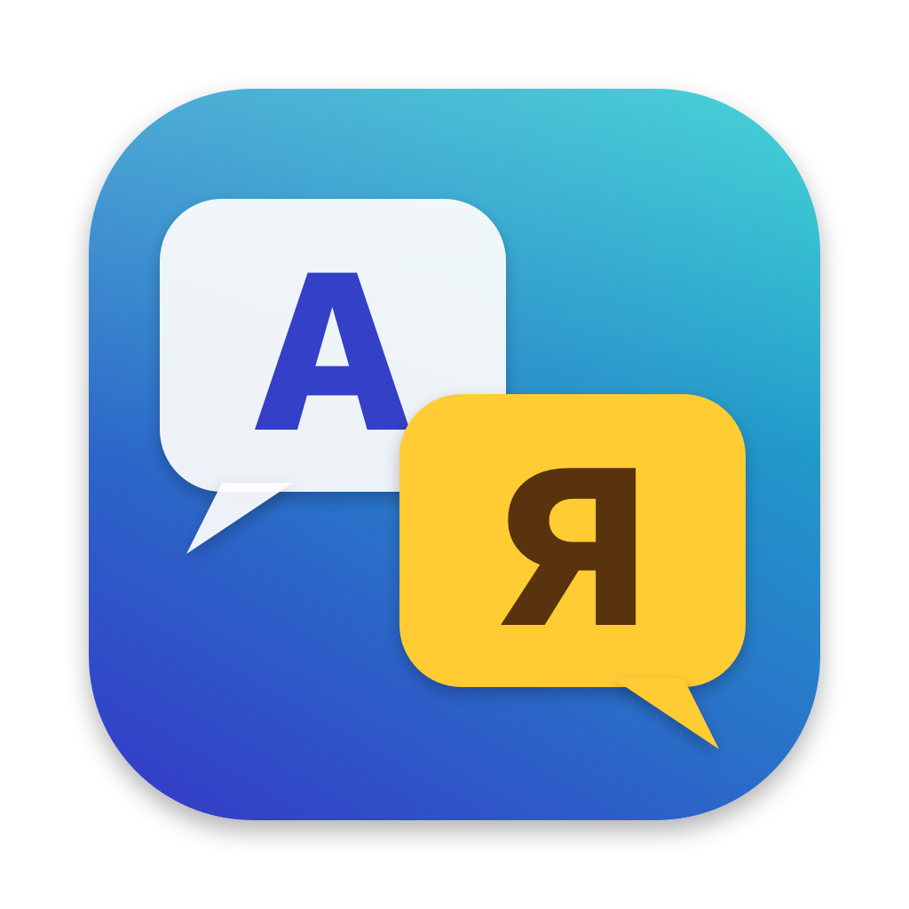

🌐 [English](../README.md) · **Русский**

# Switch Translator

Программа для macOS и Windows, которая переводит игры Nintendo Switch. Открывает образ игры (NSP/NSZ) вместе с
обновлениями и DLC, находит текст, озвучку, ролики и шрифты, переводит всё через бесплатные или платные сервисы,
переозвучивает диалоги и собирает мод для Atmosphère (или готовый образ NSP/NSZ с переводом).



Интерфейс — на 11 языках: English, Русский, Español, Italiano, Deutsch, Français, Português, 中文, 日本語,
हिन्दी, العربية. Язык берётся из системы, сменить его можно в настройках.

## Скачать

[Последний выпуск](https://github.com/Kohinor46/switch-translator/releases/latest):

- **macOS 12+** (Apple Silicon и Intel): `SwitchTranslator-macOS.dmg` — перетащи программу в «Программы».
  Программа не нотариализована, поэтому первый запуск macOS заблокирует: правый щелчок по программе → **Открыть**
  (или **Всё равно открыть** в Системных настройках → Конфиденциальность и безопасность).
- **Windows 10/11 x64**: `SwitchTranslator-Windows.zip` — распакуй и запусти `Switch Translator.exe`.
  Если SmartScreen предупредит о неизвестном издателе — **Подробнее → Выполнить в любом случае**.

При запуске программа проверяет новые версии на GitHub (выключается в настройках) и обновляется сама: скачивает
архив, сверяет его SHA-256 с выпуском на GitHub, заменяет себя и перезапускается. «Справка → Проверить обновления» —
то же по кнопке.

## Что нужно

- `prod.keys` (и при необходимости `title.keys`) **со своей консоли** — их достаёт Lockpick_RCM. Программа находит
  их на карте памяти или в `~/.switch`. Скачивать чужие ключи незаконно.
- Больше ничего: ffmpeg и whisper.cpp встроены в программу, голоса, модели распознавания и окружения Python для
  локальной озвучки программа скачивает сама по кнопке.

## Проверено на играх

Каждая игра ниже открыта, разобрана и собрана в мод на настоящих файлах игры; собранные файлы прочитаны обратно
и проверены. На настоящей консоли запущены Ring Fit Adventure и Captain Toad: Treasure Tracker (образ NSZ с
переведённым текстом и озвучкой); игры на остальных движках на консоли пока не запускались.

| Движок / формат | Игра | Текст | Озвучка | Ролики |
|---|---|---|---|---|
| **Nintendo** (MSBT в SARC, звук BFSAR/BARS/BWAV/BFSTM) | Captain Toad: Treasure Tracker | 499 реплик | 2634 звука | — |
| | Kirby and the Forgotten Land | 2503 | 2980 | 36 |
| | Mario Kart 8 Deluxe | 1265 | 9909 | 5 |
| | New Super Mario Bros. U Deluxe | 1544 | 2791 | — |
| | Paper Mario: The Thousand-Year Door | 14 878 | 7379 | 7 |
| | Ring Fit Adventure | 14 042 | 3154 | 2 |
| | Super Mario 3D World + Bowser's Fury | 1480 | 4774 | — |
| | Super Mario Bros. Wonder | 4000 | 8741 | — |
| **Nintendo времён Wii** (BMG/MSBT в RARC) | Super Mario Galaxy | 1943 | 240 | 18 |
| | Super Mario Galaxy 2 | 1797 | 251 | — |
| **Unity** (I2 Localization, CSV в TextAsset, FSB5 в `.resource` и бандлах) | New Super Lucky's Tale | 2187 | 10 058 | 32 (Bink, только просмотр) |
| | What the Golf? | 3161 | 1948 | — |
| | PAW Patrol: On a Roll! | 885 | 7805 | 3 |
| | PAW Patrol Mighty Pups Save Adventure Bay | 892 | 4847 | 35 |
| **Unreal Engine 4** (`.locres` в `.pak`, zlib и Oodle Kraken) | Yoshi's Crafted World | 1444 | — (диалоги не озвучены) | — |
| | PAW Patrol World (звук — банки FMOD) | 2242 | 3016 | 6 |
| **LEGO / Traveller's Tales** (архивы `.DAT`, озвучка DSP-ADPCM) | LEGO The Incredibles | 8069 | 19 337 | — |
| | LEGO City Undercover | 18 886 | 2748 | 12 |
| | LEGO Marvel Super Heroes 2 | 14 621 | 21 858 | — |

Определяются также игры на CRIWARE, Wwise, Godot, Ren'Py, GameMaker и RPG Maker: движок и файлы видны, а
извлекать из них текст программа пока не умеет. The Legend of Zelda: The Wind Waker HD в папке с тестами — образ
Wii U, его программа не читает.

## Поддержать проект

Switch Translator бесплатный. Если он тебе пригодился, можно поддержать разработку:

- **Банковской картой (карты российских банков):** [CloudTips](https://pay.cloudtips.ru/p/253eb33a)
- **USDT, только сеть TON:** `UQBSrz9r4NLiwa13oLu6pmEJVcxldyPba81lkBys5bnhgzJg`
  ⚠️ Отправляй только USDT в сети TON — иначе средства могут потеряться.

То же, с QR-кодом, есть в самой программе: «Справка → Поддержать проект ♥…».

## Сборка

```bash
tools/fetch-ffmpeg.sh                                       # ffmpeg для текущей платформы (вшивается в программу)
go build -o bin/switch-translator ./cmd/switch-translator   # GUI (Fyne)
go build -o bin/swtr ./cmd/swtr                             # консольная версия
```

Первая сборка идёт дольше обычного: cgo компилирует встроенный whisper.cpp (исходники — в
`internal/whisper/csrc`, лицензия MIT). Дальше Go берёт его из кэша. Без ffmpeg программа собирается, но работа с
видео недоступна. Лицензия ffmpeg — `internal/ffmpeg/LICENSE.md`.

Выпуск: `tools/release.sh` — универсальное приложение для macOS (Apple Silicon + Intel) и `.exe` для Windows
(через mingw-w64), архивы для GitHub; `tools/release.sh publish` — ещё и выпуск на GitHub. Версия —
`const Version` в `internal/gui/update.go`.

Строки интерфейса в коде — по-русски, переводы — `internal/i18n/locales/<язык>.json`;
`go run ./tools/i18n missing` показывает, каких переводов не хватает.

## Звук

Звук Nintendo (BFSTM, BFWAV, BWAV, BARS, звуки внутри BFSAR — и сжатых LZ4, как `*.bfsar.cmpbin` в Kirby) и банки FMOD
(`.bank`, FSB5 с FADPCM или PCM) программа читает сама, Ogg/Opus/MP3/FLAC/HCA — встроенным ffmpeg. Для остального
(WEM и банки Wwise, FSB5 с Vorbis или Opus, Nintendo Opus `.opus`) нужен vgmstream: под Windows программа
скачивает его сама, на Mac — `brew install vgmstream`.

## Как устроено

| Пакет | Что делает |
|---|---|
| `internal/keys` | чтение prod.keys / title.keys |
| `internal/nx` | чтение: PFS0 (NSP), NCA (AES-XTS заголовок, AES-CTR секции, тикеты), NCZ (zstd, потоковый и блочный), RomFS, обновления (BKTR), DLC, cnmt; сборка: RomFS, IVFC, NCA, cnmt, NSP, NCZ |
| `internal/engine` | определение форматов по сигнатурам и движка (Unity, Unreal, Nintendo LMS, CRIWARE, Wwise, FMOD, Godot, Ren'Py, GameMaker, RPG Maker) |
| `internal/codec` | Yaz0, zstd и LZ4 (`*.cmpbin` в Kirby): распаковка и сжатие |
| `internal/gametext` | строки MSBT (в том числе внутри SARC, RARC и Yaz0/zstd), BMG в RARC (Super Mario Galaxy), таблицы Unity, .locres Unreal и CSV LEGO: чтение и запись перевода; поиск шрифтов BFFNT |
| `internal/unity` | Unity: сериализованные файлы (*.assets, level*), бандлы UnityFS (LZ4); таблицы I2 Localization и CSV в TextAsset — чтение и запись; смещения AudioClip |
| `internal/unreal` | Unreal Engine 4: оглавление .pak (версии 1–11, zlib и Oodle), .locres и .locmeta — чтение и запись, заплатка `*_P.pak` |
| `internal/oodle` | распаковка Oodle Kraken (так сжаты файлы .pak PAW Patrol World); написана на Go заново, устройство формата — по открытому разбору ooz |
| `internal/ttgames` | архивы LEGO (Traveller's Tales) .DAT «.CC40TAD»: имена по хэшам FNV, куски ZIPX (RC4) и DFLT; перезапись с новыми данными в конце |
| `internal/bffnt` | шрифты Switch (BFFNT 4, листы BNTX: раскладка Tegra X1, BC4/BC1/BC3/R8/RGBA8): чтение и дорисовка букв из TTF/OTF в стиле игры |
| `internal/audio` | BFSTM, BFWAV, BWAV, BARS: чтение, WAV, запись озвучки обратно (BWAV — сжатым DSP-ADPCM на частоте оригинала, с CRC; BFSTM — PCM16); архив BARS (и старый, с BFWAV, как в Mario Kart 8, и новый, с AMTA v5, как в Mario Wonder) разбирается на звуки и собирается заново; BFSAR и группы BFGRP: звуки волновых архивов — чтение и запись на место оригинала; банки Wwise: встроенные WEM (только чтение); банки FMOD (`.bank`, FSB5): FADPCM и PCM — чтение и запись тем же кодеком; данные звука Unity (`.resource`, в том числе в бандлах): звук с Vorbis пишется в PCM16, смещения в AudioClip поправляются; файлы DSP-ADPCM с заголовком (`.adpcm` LEGO) |
| `internal/whisper` | whisper.cpp, собранный внутрь программы через cgo |
| `internal/translate` | MyMemory, LibreTranslate, DeepL — бесплатно; Google, ChatGPT, Claude — платно |
| `internal/speech` | звук → WAV (свой код, ffmpeg, vgmstream); распознавание Whisper / OpenAI; озвучка — бесплатно на компьютере: Piper (через sherpa-onnx, скачивается кнопкой), Silero и XTTS-v2 (своё окружение Python, ставится кнопкой; XTTS копирует голос персонажа), RHVoice (Windows), голоса macOS и Windows; с ключом: Microsoft Azure (бесплатный тариф), Яндекс SpeechKit, SaluteSpeech, Gemini, Google Cloud TTS, OpenAI TTS, ElevenLabs и Cartesia (копирование голоса) |
| `internal/project` | сценарий целиком, сборка мода и образа; результаты пишутся в папку «<образ> — перевод» рядом с образом |
| `internal/ffmpeg` | вшитые ffmpeg и ffprobe (распаковываются в кэш при первом вызове) |
| `internal/video` | ролики через ffmpeg: параметры, звук для распознавания, пересборка с субтитрами и озвучкой тем же кодеком |
| `internal/i18n` | языки интерфейса: перевод строк из кода и готовых сообщений (лог, ошибки) по шаблонам |
| `internal/gui` | окно на Fyne; обновление через GitHub, поддержка проекта |

Результаты: `report.json` (форматы и движок), `strings.json` (оригинал), `strings.<язык>.json` (перевод,
сохраняется после каждой пачки — прерванный перевод продолжается), `audio.json` и `audio/dub/` (звук),
`мод/atmosphere/contents/<title id>/romfs/…` (собранный мод, у DLC — свой title id), `мод/ПРОЧТИ.txt`
(как установить) и `<игра> [<title id>][v<версия>][RU].nsz` (образ).

Образ: игра как есть, своё обновление (код из последнего официального, версия на 0x10000 выше официальной,
к версии в настройках дописывается «-RU») и DLC (с переводом — пересобраны, остальные как есть). Новые NCA
шифруются ключами из prod.keys; подписи Nintendo у них нет, поэтому на консоли нужны патчи подписи (sigpatches).
Обновление собирается разницей (BKTR), как официальные: в нём только файлы официального обновления и перевода,
остальное консоль берёт из игры — образ весит почти как игра. После сборки проверяются NCA, собранные программой:
SHA-256 каждой совпадает с её именем. RomFS и дерево хэшей собираются байт в байт как у Nintendo (проверено
пересборкой настоящих NCA).

Вкладки идут по этапам работы: «Игра» → «Что нашлось» (здесь же выбирается язык оригинала — с какой языковой версии
игры переводить; от неё зависят строки текста, файлы речи этого языка, например `Voice.USen.pack` или
`Voice.JPja.pack`, и язык распознавания) → «Речь в текст» → «Перевод» (весь текст — реплики, речь и фразы роликов —
переводится вместе по общему словарю) → «Озвучка» (перевод речи озвучивается, в ролики вшиваются субтитры) →
«Сборка». Одинаковый текст уходит переводчику один раз. Перед переводом из уникальных слов собирается словарь игры:
имена, места, предметы, пункты меню. Словарь переводится один раз, его можно поправить руками
(`glossary.<язык>.json`), а ИИ-переводчики получают с каждой пачкой фраз статьи, которые в ней встречаются, —
термины выходят везде одинаковыми.

Пока идёт долгая задача (распознавание, перевод, озвучка…), компьютер не засыпает: на macOS — `caffeinate`,
на Windows — `SetThreadExecutionState`.

Озвучка с кодом языка в пути (`Voice.USen.pack`, `Sound/USen/…`) показывается только для выбранной версии; если своей
озвучки у неё нет или меньше, чем у другой версии того же языка, — берётся та (EUen в Ring Fit → USen, CNzh → TWzh),
а если нет и такой — английская (EUpl в Mario Wonder → EUen).

Банки FMOD (PAW Patrol World) разбираются на отдельные звуки: строка списка —
`Dialogues_ENG.bank#CH_02_Playground_SPK_21_ENG`. Если банки озвучки есть на нескольких языках, в списке только банк
языка оригинала. При сборке каждый банк пересобирается один раз: озвучка пишется тем же кодеком, на частоте и с
числом каналов оригинала.

Голоса персонажей: «Разделить по голосам» (вкладка «Речь в текст») считает у каждой реплики с речью отпечаток
голоса (модель CAM++ из 3D-Speaker через sherpa-onnx, около 40 МБ, ставится по кнопке) и собирает похожие в группы
«Голос 1», «Голос 2»… Голос можно переименовать в персонажа, слить с другим и поправить у отдельной реплики. При
озвучке с галочкой «Каждому персонажу — свой голос» каждый голос звучит своим голосом: выбранным руками или, если
озвучка умеет копировать (XTTS, ElevenLabs, Cartesia), скопированным по самым длинным репликам персонажа.

Любой звук можно открыть щелчком и поправить вручную: свой текст речи и перевод, распознать или перевести заново,
озвучить голосом, записать озвучку с микрофона (встроенным ffmpeg) или взять свой файл. Сделанное руками
помечается и массовыми шагами не перезаписывается.

Шрифты: если в шрифтах игры нет букв перевода, программа дорисовывает их на новых листах шрифта. Размер, толщину
штриха, обводку и отступы она снимает с латиницы игры, буквы-двойники (А, В, Е, о, р, с…) берёт из самой игры.
Рисует из встроенного Noto Sans Bold (лицензия OFL, `internal/bffnt/fonts`) или из своего TTF/OTF. Рядом с модом
появляется `шрифты.png` — как выглядит перевод.

Видео: речь ролика распознаётся встроенным Whisper фразами со временем, фразы переводятся вместе с текстом и, по
желанию, озвучиваются. Ролик пересобирается тем же кодеком (H.264, HEVC, VP9, VP8), в том же разрешении, с той же
частотой кадров и примерно тем же битрейтом: субтитры вшиваются в картинку, озвучка звучит поверх приглушённого
оригинала.

Звуки внутри BFSAR, групп BFGRP и старых BARS с BFWAV вписываются на место оригинала, в те же байты. Если озвучка
длиннее места, она пишется с пониженной частотой (не ниже половины исходной), а не уместившаяся и так — в
предупреждениях сборки. Озвучка при сборке подгоняется по длине под оригинал: срезается тишина по краям, длинные
фразы ускоряются без изменения высоты голоса, но не больше чем в 1,5 раза.

Текст не только Nintendo:
- **Unity** — таблицы I2 Localization (MonoBehaviour `I2.Loc.LanguageSource`, разбираются без дерева типов перебором
  вариантов плагина) и CSV в TextAsset (первая строка — коды языков). Сериализованный файл собирается заново.
- **Unreal Engine** — `.locres` внутри `.pak` (сжатые zlib или Oodle Kraken). Огромный `.pak` не переписывается:
  переведённые `.locres` складываются в заплатку `<архив>_tr_P.pak` рядом, движок подключает её поверх. Исходный
  язык — из `.locmeta`: если в `.locres` языка есть не все ключи (у PAW Patrol World в `en` 672 из 2242, остальное
  игра берёт из исходного `eo`), недостающие добавляются с исходным текстом и хэшем.
- **LEGO** (Traveller's Tales) — `stuff\text\text.csv` в `GAME*.DAT`/`PATCH.DAT`, колонка на язык; берётся версия из
  `PATCH.DAT`. Архив пишется как был, с новыми данными и оглавлением в конце. Реплики `audio\…\*_eng.adpcm` — в
  списке звука.
- **Super Mario Galaxy 1/2** — `MessageData/*.arc` (RARC): BMG в первой части, MSBT во второй. Служебные коды BMG —
  `{{bmg:…}}`, кодируются обратно байт в байт.

Консольная версия: `swtr -locale EUen -build [-ttf свой.ttf | -font FontData.szs | -glyphs=false] игра.nsz`;
`-glossary` перед переводом собирает и переводит словарь, `-image nsz` (или `nsp`) — образ, `-fit=false` — без
подгонки озвучки по длине. Обновления и DLC рядом с образом находятся сами (`-extras` — перечислить вручную).

## Пока не умеет

- Распаковывать другие методы Oodle (Mermaid, Selkie, Leviathan) — встречался только Kraken.
- Дорисовывать буквы в шрифты Unity (TextMeshPro), Unreal, LEGO и Galaxy: в Lucky's Tale нет кириллицы; в What the Golf,
  Mighty Pups, PAW On a Roll, Yoshi и LEGO русский уже есть в самой игре.
- Пересобирать ролики Bink и CRI USM — их можно только посмотреть; переводить надписи, нарисованные в кадрах роликов.
- Вписывать озвучку в банки Wwise, Nintendo Opus и банки FMOD с Vorbis или Opus.
- Вытаскивать звук из ассетов Unreal (USoundWave) и волновых банков JAudio (.aw, Galaxy): в этих играх нет
  озвученных диалогов.
- Раскладку справа налево для арабского (Fyne выводит текст слева направо).

## Тесты

```bash
go test ./...
```

Тесты собирают NSP/NSZ на случайных ключах и проходят весь путь до файлов RomFS и строк MSBT. Тесты на настоящих
играх включаются переменными окружения (`SWTR_ALL`, `SWTR_TEXT_GAME`, `SWTR_PAK_GAME`… — см.
`internal/project/allgames_test.go`).

## Лицензии

Сам Switch Translator — под лицензией MIT (`LICENSE`). У встроенных компонентов — свои лицензии:

- Встроенный ffmpeg — сборки GPL (BtbN, martin-riedl.de), см. `internal/ffmpeg/LICENSE.md`.
- whisper.cpp и ggml — MIT (`internal/whisper/csrc/LICENSE`).
- Noto Sans для дорисованных букв и субтитров — OFL (`internal/bffnt/fonts`).
- Распаковщик Oodle Kraken (`internal/oodle`) написан на Go заново; устройство формата известно по открытому разбору ooz.
